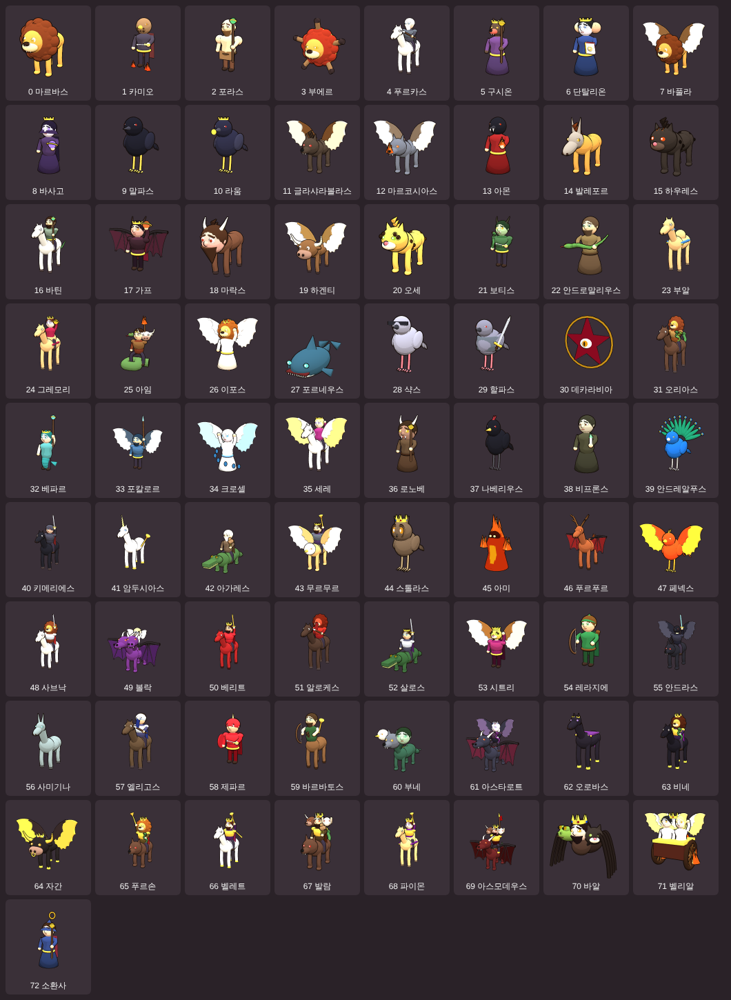

# 솔로몬의 계약 (가제)

솔로몬의 72악마와 계약하고, 랜덤하게 성장시키고, 조합으로 9왕을 불러내는 **디아블로풍 3D 방치형 게임** 프로토타입이에요. 1인 개발 + Claude·GPT 협업으로 만들고 있어요.

## 실행하기

`index.html` 파일 하나로 돌아가요. 내려받아 브라우저로 열면 바로 플레이할 수 있어요. 3D 그래픽은 인터넷에서 three.js(r128)를 불러와서 그려요. 인터넷이 안 되거나 WebGL을 못 쓰는 환경에서는 2D 그림으로 자동 전환돼요. 진행 상황은 브라우저에 저장돼요.

GitHub Pages를 켜면(Settings → Pages → Branch: `main`) 휴대폰에서도 링크로 플레이할 수 있어요.

## 폴더 구성

| 경로 | 내용 |
|---|---|
| `index.html` | 게임 전체 (HTML·CSS·JavaScript 한 파일) |
| `docs/game-design.md` | 현재 규칙과 수치를 정리한 기획서 |
| `docs/monsters.md` | 72악마 명단, 계급, 등장 지역, 모습, 9왕 조합법 |
| `prompts/image-prompts.md` | GPT로 정식 그림을 만들 때 쓰는 프롬프트 |
| `art/demons-3d.png` | 72악마 + 소환사 3D 모델 한눈에 보기 |
| `COLLABORATION.md` | Claude·GPT 역할 분담과 작업 규칙 |

## 현재 들어간 기능

- 디아블로풍 3D 쿼터뷰 전투: 자동 사냥 + 수동 조작(조이스틱·WASD, 적 지정, 경험치·골드 +25%)
- 72악마 3D 모델: 부품 조합식(머리·몸·탈것·날개·무기·왕관), 툰 셰이딩과 잉크 외곽선
- 7개 지옥 지역 × 20단계, 5단계 난이도
- F ~ SSR 10등급 + 각성 ★3, 레벨업마다 바뀌는 랜덤 성장
- 합성, 9왕 조합법, 환생
- 장비 3부위와 장비 성장
- 도감 72체와 수집·세트 보상
- 오프라인 보상

## 다음 할 일

- [ ] 요괴 정식 3D 모델 또는 그림 (GPT·3D 생성 도구)
- [ ] 악마별 고유 스킬, 9왕 전용 연출
- [ ] 균열 콘텐츠, 장비 옵션
- [ ] Steam 출시용 포장 (Electron 등)
